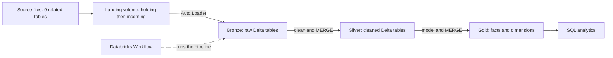

# E-commerce Lakehouse: Incremental ETL Pipeline on Databricks

An end-to-end data engineering project on Databricks. Raw e-commerce files are loaded incrementally through a bronze, silver, and gold medallion architecture, modeled into facts and dimensions, and kept up to date with Delta `MERGE`.

## Architecture

## What it covers

- **Incremental ingestion:** Auto Loader loads only new files, using a checkpoint, so a re-run never reloads data.
- **Data quality (silver):** deduplication on business keys, null-key and range checks, type fixes, zip-code repair, and English category names.
- **Idempotent upserts:** Delta `MERGE` on business keys in silver and gold. Re-running a batch adds no duplicates.
- **Dimensional model (gold):** a constellation schema with 2 fact tables and 4 dimensions.
- **SCD Type 2:** the customer dimension keeps history (`start_date`, `end_date`, `is_current`), and facts are linked to the customer version valid on the order date (point-in-time join).
- **Orchestration:** the pipeline notebook runs as a Databricks Workflow.

## Data model (gold)

| Table | Type | Grain |
|---|---|---|
| `fact_order_items` | Fact | One row per order item |
| `fact_orders` | Fact | One row per order (delivery time, delay, payments, review score) |
| `dim_customer` | Dimension (SCD Type 2) | One row per customer version |
| `dim_seller` | Dimension | One row per seller |
| `dim_product` | Dimension | One row per product |
| `dim_date` | Dimension | One row per calendar day |

## Results

The source data was split by order date into an initial load and three later batches to simulate data arriving over time. After all four loads:

| Table | Rows |
|---|---|
| Orders | 99,441 |
| Order items | 112,650 |
| Order payments | 103,883 |
| Order reviews | 99,224 |

- 0 duplicate keys in every silver and gold table.
- Re-running a batch loads nothing new (Auto Loader checkpoint) and `MERGE` inserts 0 rows.

## Notebooks

| Notebook | Purpose |
|---|---|
| `01_bronze` | Load the raw files into bronze Delta tables with load metadata |
| `02_silver` | Clean each table into silver |
| `03_gold` | Build the dimension and fact tables |
| `04_SCD type 2` | SCD Type 2 on the customer dimension using `MERGE` |
| `05_split batches` | Split the data into an initial load and later batches |
| `06_load_initial` | Load the initial chunk with Auto Loader |
| `07_load_batches` | Load a later batch and check only new rows are added |
| `08_silver_merge` | Incremental silver with `MERGE` |
| `09_gold_merge` | Incremental gold facts with `MERGE` and point-in-time join |
| `10_run_batch` | The full pipeline for one batch, run as a Databricks Workflow |

## Tech stack

Databricks (Free Edition, serverless), PySpark, Spark SQL, Delta Lake, Auto Loader, Unity Catalog volumes, Databricks Workflows.

## Notes

- Data source: a public Brazilian e-commerce dataset from Kaggle.
- The incoming data is simulated by splitting the dataset by date.
- The Workflow is started manually with Run now. No schedule is configured.
